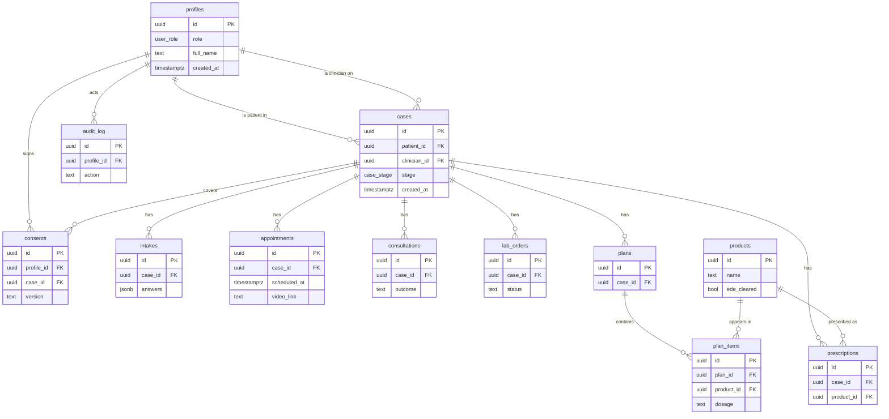

# Database ERD — Telehealth MVP

*The data model, as built in `supabase/migrations/`. Renders as a diagram on GitHub. Last updated: 2026-11-23.*

- **profiles** = people (patients, clinicians, admins); `id` is the Supabase Auth user id.
- **cases** = the spine — one patient's treatment journey.
- Step tables (**intakes, appointments, consultations, lab_orders, plans, prescriptions**) clip onto a case via `case_id`.
- **products** = the EDE-gated catalog; **plan_items** = the join table (many products per plan).
- **consents** + **audit_log** = the compliance layer.

**How to read the lines:** `||` = one, `o{` (crow's foot) = many. So `profiles ||--o{ cases` means *one profile → many cases*, and each case has exactly one patient.
